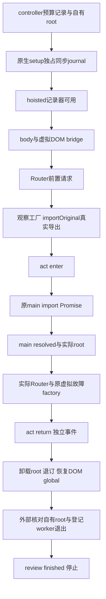

# P4-D15-R1：生产入口前置阶段取证报告

任务状态：`review / finished`。技术顾问已停止目标运行，等待头脑风暴总控核对；这是诊断交付，不是独立验收。依据control `2026-10-03T01:07:00+08:00`、[R1任务卡](coordination/prompts/p4-d15-r1-bootstrap-technical-adviser.md)和[总控裁定](p4-d15-bootstrap-coordinator-review.md)。全部数据为虚拟数据。

## 1. 唯一问题的回答

**在attempt-1的同一个隔离worker内，真实React Router导出已取得，实际main已导入完成，React act也已单独返回，没有剩余bootstrap等待。** Router导出的`createHashRouter`类型为function；实际main的`desktopRoot`随后确认并成功卸载。原DailyFinancePage虚拟故障factory命中1次。

证据为[原始worker journal](coordination/diagnostics/p4-d15-r1/attempt-1/results/worker.journal.jsonl)、[controller journal](coordination/diagnostics/p4-d15-r1/attempt-1/results/controller.journal.jsonl)及[真实进程结果](coordination/diagnostics/p4-d15-r1/attempt-1/results/process.json)。22条worker记录序号连续、PID38832/parent35256一致；controller创建root35256并在运行中登记该父子关系。

这不能解释旧D15-P3为何15秒后没有回执。R1加入了Router前置解析，改变了观察依赖的加载顺序；旧P3没有持久阶段，仍不能判断其main/act到哪一步。旧失败不被新成功覆盖。LAZY-001、UI-02和P4-B均未关闭。

## 2. 固定起点、版本和实际预算

接单前新[起点清单](coordination/snapshots/p4-d15-r1-start.sha256)464/464匹配，SHA-256 `1a170a063dcee793aa0310809da8fe215dbd1a005a6fbdfd33530f5e67b27225`，staged=0。接单后本人状态文件是唯一授权的固定输入变化，其他463项复核一致。没有Git写操作、产品修改或其他角色调度。

只读复用任务指定R5普通依赖：Node24.21.0、Vitest5.0.2、Vite7.3.6、React/React DOM19.3.0、React Router8.4.0、jsdom30.1.1；TypeScript6.0.3只做静态转译检查，@vitest/mocker5.0.2只读源码/元数据。Node与原6项依赖元数据摘要匹配，额外2项元数据在本次前后核对一致。没有安装、下载、服务、Electron/EXE、sidecar、打包、微信或独立测试恢复。

| 运行 | Vitest CLI / worker | main请求 | process.json耗时 | root真实退出码 | 超时 / controller强杀 |
| --- | --- | --- | --- | --- | --- |
| attempt-0 | 1 / 1 | 0 | 724ms | -1 | false / true；controller读取失败后定向结束自有树 |
| attempt-1 | 1 / 1 | 1 | 6440ms | 0 | false / false |
| 合计 | 2 / 2 | 1 | 7164ms | 分别保存，不合并 | 前置观察修正1/1；没有第三次 |

两个process.json字段取值时点与controller最后记录时点不同：controller_finished分别729/6447ms，合计7176ms；attempt-1内部累计字段7166ms是更早的取值。都在15秒单进程、10秒测试、60秒累计目标运行预算内。controller于14.5秒开始硬限收口，为原15秒内采集预留500ms，本轮第二次未触发。没有延长等待。

01:27首次安全停止后，用户再次发送“继续”；02:54起恢复只读检查，control仍为01:07。两次之间没有本任务活动后台进程；离线整理与聊天间隔不冒充目标运行耗时。01:36状态检查点未及时刷新已在本人日志如实记录，恢复后重设检查点；没有无限生成或重试。

## 3. 静态追踪与新观察入口

当前安装Vitest的`dist/chunks/run.C5UmxDPh.js:3407`为runSetupFiles；`collectTests:3438`先await setup，再`runner.importFile(filepath, "collect")`。`index.DGdajAO2.js:7357`把importOriginal交给mock工厂；`index.hTNFpC24.js:329`等待mock.resolve，`:355`的importActual执行resolveId/fetchModule/cachedRequest。这里只证明静态调用关系，不预设工厂在body前执行，也不宣称框架死锁。

新[setup](coordination/diagnostics/p4-d15-r1/attempt-1/setup.mjs#L1)只导入原生fs/path/url，`:20`以wx独占创建journal，每条writeSync并fsync后返回；`:44`写worker_start，`:46`写journal_ready。global记录器先建立，[vi.hoisted](coordination/diagnostics/p4-d15-r1/attempt-1/bootstrap.test.tsx#L6)直接使用，不依赖body才赋值的回调，没有记录器/观察模块相互动态import。写失败固定报错并退出91，不继续无证据目标。

body建立同样虚拟bridge/jsdom/global后，[前置await](coordination/diagnostics/p4-d15-r1/attempt-1/bootstrap.test.tsx#L76)请求同一个`react-router`specifier；工厂[第26行](coordination/diagnostics/p4-d15-r1/attempt-1/bootstrap.test.tsx#L26)记录enter、实际import的enter/terminal，只保存createHashRouter类型布尔。前置成功后才进入真实main。

实际产品链仍是[main.tsx第9行](../apps/desktop/src/renderer/main.tsx#L9)createRoot、StrictMode render；[module-routes第10行](../apps/desktop/src/renderer/module-routes.tsx#L10)默认内置动态页面loader、[第56行](../apps/desktop/src/renderer/module-routes.tsx#L56)安全错误映射、[第113行](../apps/desktop/src/renderer/module-routes.tsx#L113)真实createHashRouter；[contribution](../apps/desktop/src/modules/daily-finance/contribution.ts#L3)和[Shell](../apps/desktop/src/shell/Shell.tsx#L6)只读。

## 4. attempt-0首次停止与唯一前置修正

首次[source清单](coordination/diagnostics/p4-d15-r1/attempt-0/probe-source.sha256)六项已在启动前冻结，SHA-256 `ce285006670f71700415ce969ccd1e8a0ab57cbf8a6ee315573688bce264830e`。TS、三个MJS和PowerShell静态语法无错误，未以collect-only代替运行。

首次[worker记录](coordination/diagnostics/p4-d15-r1/attempt-0/results/worker.journal.jsonl)只有seq1 worker_start和seq2 journal_ready；[controller记录](coordination/diagnostics/p4-d15-r1/attempt-0/results/controller.journal.jsonl)在638ms进入controller_failure、随后定向结束root38256。首次[process.json](coordination/diagnostics/p4-d15-r1/attempt-0/results/process.json)保持worker=null/failureCode=controller_or_observer_failure。第一次catch没有保存kind/HResult，**首次具体异常类型保持unknown**，不回填为新异常。

停止后直接读取已保存journal，worker39044的parent38256与自有root一致，两者PID均已不存在，另存[退出后门禁](coordination/diagnostics/p4-d15-r1/attempt-0/results/pre-main-correction-gate.json)。journal序列连续、原生写失败立即退出的约束和probe的线性前置await共同证明：没有到达hoisted/body，更没有main_import_enter。不是用“stdout没输出”猜测main未开始。

新原生虚拟文件在同一PowerShell内验证读取接线，不启动任何Vitest/产品目标：writer保持打开时ReadAllText抛IOException/HResult -2147024864、Win32低位32；FileStream(Read, FileShare.ReadWrite)能读到相同虚拟内容。该独立证明定位了一个Windows共享读取问题，不能代替首次未捕获的异常或旧P3根因证据。

首次17个文件已独立冻结在[attempt-0 delivery](coordination/diagnostics/p4-d15-r1/attempt-0/delivery.sha256)，摘要 `1eeec3c963dd0bf6178802f82a314687a7b24e88ccf7a8878d614698371c5620`。父子身份/退出、main0、固定输入不变和首次材料保存条件成立后，才使用一次前置修正。

修正仅在新[controller第75行](coordination/diagnostics/p4-d15-r1/attempt-1/run-once.ps1#L75)采用ReadWrite共享读取并解析完整newline，在catch新增固定调用码/kind/HResult；root/attempt/cache指向新目录并检查首次摘要。setup与probe逐字同摘要。新[source清单](coordination/diagnostics/p4-d15-r1/attempt-1/probe-source.sha256)六项重新冻结，SHA-256 `4b0519d1bd632343da94ffbeb6d776b069c12cf41e519f046c08ca7dd8ad5427`，没有覆盖首次材料。

## 5. attempt-1实际持久阶段

以下是同一worker_start起算的相对时间；表格合并展示，不减少原始22条记录。未发生的reject/worker_exit不补造。

| seq | 阶段 | 相对ms | 实际含义 |
| --- | --- | --- | --- |
| 1–3 | worker_start / journal_ready / hoisted_ready | 0.126 / 5.152 / 74.160 | 原生日志先于测试模块初始化可用 |
| 4–6 | body_enter / virtual_dom_bridge_ready / router_preflight_enter | 4685.927 / 4771.269 / 4775.396 | body开始，虚拟环境完成，开始观察前置解析 |
| 7–9 | factory_enter / actual_import_enter / actual_import_resolved | 4780.130 / 4783.552 / 4892.377 | actual Promise返回，函数类型布尔true |
| 10–12 | router_preflight_resolved / act_enter / main_import_enter | 4895.263 / 4896.848 / 4898.865 | Router前置完成后才请求真实main |
| 13–14 | main_import_resolved / root_created | 5381.639 / 5384.537 | main Promise完成，实际desktopRoot导出确认 |
| 15–17 | router_created / virtual_factory_throw / act_return | 5398.842 / 5442.373 / 5445.133 | 实际Router建立、原虚拟factory命中1、act另行返回 |
| 18–20 | root_unmount_enter / root_unmounted / observer_unsubscribed | 5447.144 / 5467.602 / 5469.462 | 立即卸载真实root，取消观察订阅 |
| 21–22 | dom_globals_restored / body_finished | 5471.629 / 5473.608 | DOM/全局/bridge清理完毕，body结束 |

真实actual import耗时108.825ms，main import耗时482.774ms，act总耗时548.285ms。main_import_enter只是导入请求，不能独自证明模块正文已执行；本次还有main_import_resolved、真实root导出及成功unmount，才确认实际入口完成。

worker_start到body_enter有4.686秒，hoisted到body之间约4.612秒。期间有React/jsdom/contribution等静态依赖加载，但没有逐个依赖阶段；不把这段时间指定为某个库的故障。最终所有bootstrap await均完成，**没有仍pending的actual/main/act调用**。

## 6. main Promise、act和卸载的分离

[probe第82行](coordination/diagnostics/p4-d15-r1/attempt-1/bootstrap.test.tsx#L82)先同步写main_import_enter，再创建原始import Promise；旁路then只记resolve/reject，不把其派生Promise交给act、不吞原错误；回调仍await原Promise。main完成是seq13，act返回是seq17，中间还有真实Router和虚拟factory事件。

因此“入口导入成功”不能代替“React处理已返回”，两者任何一个pending时都应分别保留enter和缺失terminal。R1没有等待错误页，也没有通过延长act、flush、navigate、revalidate或再次import得到结果。[卸载第97行](coordination/diagnostics/p4-d15-r1/attempt-1/bootstrap.test.tsx#L97)只在入口完成后收口。

## 7. 语义保持与限制

原DailyFinancePage mock仍throw `VIRTUAL_CHUNK_UNAVAILABLE`；没有预加载真实目标页面、替代loader、替代Router或新增reject。Router工厂展开全部actual导出，createHashRouter转发原args与原route/errorElement，返回原实际Router对象；空状态观察订阅只用于取消收口，不导出状态。默认loader、贡献注册、虚拟host module/runtime、jsdom/global和StrictMode入口保持原条件。

相较旧P3，这次在body显式先await Router，去掉旧loader包装、Router状态/DOM采样和5秒DOM轮询。前者会预热Router缓存，后者缩小观察范围；**不具备与旧冷入口P3完全相同的加载时序**。新结果只回答R1问题，不能宣称已复现并修好了旧超时。

原四条业务要求仍完整保留：安全错误提示、Shell存在、模块导航存在、统一Agent入口存在。R1没有给它们新增pass，也没有因act返回、fault1或root清空代替这些断言。显式有限重试、持续失败不循环、健康页面切换与状态保持同样未执行；测试方已有证据只读保留。

## 8. 资源、隐私与终点核对

第二次cleanup证明rootEmpty/globalRestored/domClosed均true，bridge订阅2/退订2/active0、settingsWrites0，Router观察取消1次。两次root和journal确认的worker都已退出。attempt-1有body/finally阶段，但worker自己的process.exit事件没有到达；**其具体退出方式/exit code未知**，不把父CLI的exit0代给worker。controller的已持有worker句柄核对HasExited=true，只证明该登记worker已结束。

资源范围限两个自有root及对应journal worker，不做全Node kill、不用总进程数阈值，不把权限失败空集合视为零残留。没有宣称全系统进程树或所有第三方会话为零。

每次stdout/stderr分开保存首次流边界与行序，除固定RUN/记录器错误码外整行脱敏，process.json保存原/脱敏字节数和删敏行数。第一次stdout90字节、第二次357字节，stderr均0；没有Error/stack/整个模块/URL/DOM/私密字段输出。journal仅固定阶段、PID/parent、seq/ms、安全布尔和分类。

[终点audit](coordination/diagnostics/p4-d15-r1/attempt-1/end-audit.json)结果：新起点其他463/463匹配、本人角色授权变更1；旧D15 delivery其他30/30匹配、本人旧角色摘要授权变更1；旧D15冻结8/8、当前冻结6/6、外部源码389/389、产物140/140及Node/依赖元数据匹配，staged=0。Git读取有配置访问警告，只记录warning=true，不修改配置；不把旧31项delivery整体写成仍然匹配。

仅新R1/temp经绝对边界和无reparse核对后删除1个缓存文件，[缓存回执](coordination/diagnostics/p4-d15-r1/temp-cleanup.json)证明temp已不存在。首次失败、源码、journal、双流与旧D15均未删除。最终[交付摘要](coordination/diagnostics/p4-d15-r1/delivery.sha256)覆盖新报告、本人状态及所有本任务证据，清单本身除外。

## 9. 给总控的最小建议与交接

可以核对并接受“R1观察通道已能取得真实Router、完成main并区分act”的诊断结果。最小观察基础设施修正是原生setup同步journal、Windows活动writer的ReadWrite共享读取、关键await独立enter/terminal、首次安全异常kind/HResult，以及自有PID的实时登记/退出后补证；不需要据此修改产品、打包或继续等待。

尚待总控决定的是原独立业务验证的下一步及观察加载顺序合同：是否允许Router前置预热、如何保留冷入口真实性，如何在同样有限预算下保留四条原断言和故障终态证据。R1没有生成后续Prompt、接口冻结或新角色任务，也不自行启动复验。

旧P3根因、完整Router错误槽/DOM提交、worker退出机制仍unverified。后续若只调查旧P3，具体缺失的是其第一条初始化/await阶段回执；不能仅靠R1成功或再等更久补齐。没有产品返修依据，不新定级缺陷。

## 10. 本次实际数据流与停止点

attempt-0停在B完成后controller读取失败，已保留；attempt-1到达N。main1/1、前置修正1/1、CLI2/2已止，不执行第三次，不恢复独立/Windows，不关闭项目验收项。
