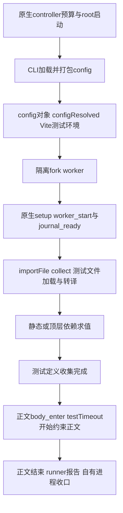

# P4-D16：测试初始化定位与独立验收路线裁定

技术顾问交付：`review / finished`，待总控审阅冻结。控制依据为`2026-10-03T16:08:00+08:00`及[D16任务卡](coordination/prompts/p4-d16-harness-and-acceptance-technical-adviser.md)。本报告只裁定测试基础设施与后续验收路线；没有运行产品main、页面loader、故障fixture、旧P/A/B或Windows，不新增矩阵passed。

## 1. 给用户的卡点说明与结论

旧A连测试正文都没有开始：它已经建立日志，但随后加载测试文件及其依赖的过程没有留下细分记录，最终被整个进程的15秒上限结束。因此目前不能说应用没有正确显示错误页。另一个问题已经能够确定：原流程要求A先通过，才允许真正检查界面公开行为的B执行；这使辅助观察工具的初始化问题连续阻断了产品判断。

本次完成两个新的最小初始化实验。jsdom/React逐段导入以及与A相同的三个静态依赖都正常进入正文并退出，固定依赖并非必然无法加载。**旧A具体超时根因仍为unknown。建议采用“无包装公开B独立取得证据，A仅在失败需要内部归因时使用”的路线，同时把初始化、业务正文和收口分别计时、分别留证。** B仍保留冷入口、有效持续故障和原四条断言，不能拿P或本次诊断代替它。

该建议须总控冻结后由测试角色执行。D16动态诊断已停止，不使用第3次预算盲试，不创建D16-R1或新任务卡。

## 2. 输入、角色与验证范围

接单前[D16固定起点](coordination/snapshots/p4-d16-start.sha256)596/596原始字节SHA-256匹配，摘要`26bc182348d17ec4832125289adc8a0d2f1595f5ac402e445d2563c660391d23`。清单为UTF-8无BOM、ordinal排序的仓库相对路径、每行`path<TAB>sha256<LF>`；没有用CRLF归一化掩盖变化。后续仅本人角色日志为其中的授权变化，其余595项保持。

R4-R3[52项交付](../tests/independent/desktop/evidence/r4-r3/delivery.sha256)按仓库根核对52/52，清单SHA-256 `44c36fca1341901a26594c7665cb25ffa81c86e403a322b30da5493f484148cc`；[15项源码](../tests/independent/desktop/evidence/r4-r3/cold-source.sha256)按`tests/independent/desktop/`核对15/15。D15-R1旧清单其余39项保持，本人状态变化另列，不宣称旧40项整体匹配。

只读固定R5工具：Node24.21.0、Vitest5.0.2、Vite7.3.6、React/DOM19.3.0、Router8.4.0、jsdom30.1.1、TypeScript6.0.3。Node可执行文件及7包元数据前后同摘要；React DOM和Router的`require.resolve('react')`指向相同真实React文件，未求值Router。外部源码389/389、产物140/140保持，staged=0。见[基线](coordination/diagnostics/p4-d16/baseline.json)、[E1后核对](coordination/diagnostics/p4-d16/e1-audit.json)与[E2后核对](coordination/diagnostics/p4-d16/e2-audit.json)。这不是完整依赖图或产物的新增独立验收。

## 3. CLI到正文的真实顺序

固定Vitest源码`dist/chunks/run.C5UmxDPh.js:3407`执行setupFiles；`:3438`先await setup，`:3446`再`runner.importFile(filepath, "collect")`，之后收集测试定义。`:2628/:2683/:3251`把testTimeout施加于测试函数包装器；它不等于整个CLI的启动与收集时限。

固定Vite `dist/node/chunks/config.js:35834/:35985`先加载/打包配置，默认bundle可能在最近node_modules/.vite-temp写临时配置；本次各新实验先建立自己的空node_modules目录，使这类临时文件也留在新任务范围。没有安装或复制依赖。实际依赖仍由精确alias指向固定R5。

Vitest `index.C-uw7tH9.js:10516`还定义模块图预取，`:10532`区分动态import依赖。resolve/load/transform到达与模块求值完成不同：解析某个ID不能证明执行过该模块。我们未调用或修改此内部函数，也没有记录旧A本次走过哪个内部分支，不能把预取代码存在认定为死锁原因。



图中F/G可能涉及CLI与worker之间请求，不能把不同进程的相对毫秒直接相减。新server journal的resolve/load/transform事件仅叫`*_hook_seen`，不预写“解析成功”或“求值完成”；worker的实际await返回才记resolved。

旧A原[worker记录](../tests/independent/desktop/evidence/r4-r3/cold-trace/worker.journal.jsonl)最后是journal_ready；[controller](../tests/independent/desktop/evidence/r4-r3/cold-trace/controller.journal.jsonl)1672ms登记worker，14512ms进入硬限收口，process回执14595ms/exit-1。原来缺少F/G/H阶段，因此最小未完成边界是**setup完成后，测试模块collect导入返回之前**。源码上的下一关键调用是`runner.importFile(A, "collect")`；原回执没有它的enter，不能冒称已证明卡在其某一内部依赖。

## 4. 候选原因、支持与反证

| 候选/问题 | 支持证据 | 反证或限制 | 裁定 |
| --- | --- | --- | --- |
| Router别名/门面循环导致正文前阻塞 | 旧A配置确实有门面与真实包alias | A前三行仅vitest/jsdom/React；门面需后续main链，旧无facade记录；真实alias不回指自身 | 不作为当前有依据的正文前根因；解析预取与实际求值必须分开 |
| React/Router混用物理根 | 这是Context类问题的合理检查项 | 固定alias与require.resolve实路径一致；未运行Router产品链，不能扩展为全部运行时身份验证 | 没有发现根不一致；不能用它解释旧停点 |
| setup或controller日志通道失效 | 历史D15-R1有共享读取工具问题 | R3使用ReadWrite共享读取并登记了worker；两个完整setup事件，safeFailure=null，收口由deadline触发 | 本次旧A无相同工具错误证据，不能套用历史根因 |
| jsdom/React安装损坏或普遍不可加载 | A正文前确实加载这两项，P不加载jsdom | E1两项导入实际返回；E2静态形式也完成，无依赖变化 | 普遍不可加载假设被反证；旧瞬时行为仍未知 |
| **H1：特定运行时的依赖加载/调度耗时变动** | E1 jsdom导入占5903ms；E2整段静态初始化不足1秒，启动耗时确实可变 | 非同一加载形式/时点，OS文件缓存未清空；没有旧A依赖enter/terminal，不能证明它仅仅慢 | 保留的第1个假设，unknown；不指定杀毒/磁盘/某库为根因 |
| **H2：完整A测试模块的收集/转译/依赖图路径特有等待** | 旧A停在collect边界；新极小模块不含A的动态main文本和全部正文 | 新E2静态形式已通过；没有旧图边/Promise终态，不能确认循环或框架缺陷 | 保留的第2个假设，unknown；不再增加其他无证据假设 |
| 初始化与业务共用15秒且阶段不可见 | 原controller第64/102行同一计时器覆盖启动至收口，A正文0 | 硬限本身按原卡执行正确；不等于“加时就会通过” | 已确认的预算/可观测性设计限制，需分阶段合同 |
| A失败阻止B执行 | 原controller第21行把cold-public的priorPhase设为cold-trace | B的公开四断言不使用A遥测；R3 B根本未执行 | 已确认的流程耦合，应由总控解除执行依赖 |

产品问题本轮`unverified`；没有新P1。新初始化工具没有实际运行错误、无需修正。明确已确认的是旧证据缺口和A→B流程耦合，不能把它们冒充旧A超时的内部根因。

## 5. 两项新实验的首次结果

[计划](coordination/diagnostics/p4-d16/probe-plan.md)在启动前形成；各次源码/config/controller均静态检查并冻结。共用工具未在两次之间改变。scope plugin拒绝任何apps/src/旧独立目标请求，两次scopeViolation=false，探针源码仅含允许的基础设施依赖。

| 实验 | 问题与阶段证据 | 真实结果 |
| --- | --- | --- |
| E1：顶层分段导入 | worker51.015ms进入测试模块；jsdom54.144→5957.493ms返回，React5970.741→5986.744ms返回；5991.276ms模块完成，body6000.794→6003.124ms | CLI6982ms、exit0；worker10/server17/controller5条；root19044、worker4792均退出 |
| E2：新极小静态形式 | 与A相同vitest/jsdom/React静态依赖；887.482ms模块求值完成、891.365ms注册完成，body899.291→902.951ms | CLI1703ms、exit0；worker6/server17/controller5条；root29088、worker31888均退出 |

E1[worker](coordination/diagnostics/p4-d16/e1/results/worker.journal.jsonl)、[server](coordination/diagnostics/p4-d16/e1/results/server.journal.jsonl)、[process](coordination/diagnostics/p4-d16/e1/results/process.json)；E2[问题说明](coordination/diagnostics/p4-d16/e2/question.md)、[worker](coordination/diagnostics/p4-d16/e2/results/worker.journal.jsonl)、[server](coordination/diagnostics/p4-d16/e2/results/server.journal.jsonl)、[process](coordination/diagnostics/p4-d16/e2/results/process.json)。各server记录配置返回、配置解析/测试环境、测试模块hooks、收集完成和runner结束，unhandledCount=0。

E1 jsdom实际await为5903.349ms，React16.004ms；E2只记录静态依赖全部完成，不伪造逐项耗时。新worker与Vite缓存隔离，但OS文件缓存/系统调度未隔离；速度差不是因果对照结论。两个极小模块没有完整旧A正文、新scope plugin也不同，因此不能说“旧A已经通过”。

总诊断CLI **2/3**、工具修正0、main/loader/fixture/旧目标0；process字段合计8685ms，controller末事件6991+1708=8699ms。E2累计字段8686ms为稍后取值，差异仅记录时点。每次120秒总硬限含收口，118秒开始强制收口、2秒预留；本轮都未触发。正文testTimeout10秒，实际正文均毫秒级。第3次不运行：没有新增问题需要用它重复验证同一依赖。

E1[source清单](coordination/diagnostics/p4-d16/e1/source.sha256)10项，SHA-256 `e70e2d3bede063b30b398c5aac84465f9bf09ef9e36f7ec74c221bb65f10feef`；E2[source清单](coordination/diagnostics/p4-d16/e2/source.sha256)11项，SHA-256 `b955dc1dcbe124d0e60b7e473fa87d13c6943ffe1403bf6d59252f0598e75636`。两者相对基准均为`docs/coordination/diagnostics/p4-d16/`，不是各自e1/e2目录。

## 6. A→B依赖裁定

原[controller第21行](../tests/independent/desktop/r4-r3-run-once.ps1#L21)令B读取A的result/process；这条执行依赖与界面公开要求之间不存在必要因果关系。A额外包装loader、订阅Router、记录abort，适合解释失败；B才直接使用真实Router、不包装loader，能够检查观察层不介入时的公开行为。

| 路线 | 得到什么 | 风险与代价 | 选择 |
| --- | --- | --- | --- |
| 保留A必经，再B | 先取得内部传播遥测 | 观察初始化或包装扰动继续阻塞B；已连续发生，不能拿A失败预测B | 不推荐 |
| **B独立运行，A仅为失败归因** | 先取得真实公开界面的独立证据；每个节点只按自己条件判定 | B不会提供内部abort/Router错误槽日志，归因不充分时必须承认unknown | **推荐**，B仍需自己的故障有效性与冷入口证据 |
| 直接跳到已打包Windows故障 | 可触及真实chunk网络与设备层 | 当前真实注入/窗口/收口成本更高，不能由开发19项smoke代替；本轮无权限 | 不作为解决初始化的最小路线；保留为后续矩阵层 |

四条公开断言、故障有效性、冷入口与辅助遥测应按下表分别取证：

| 要求 | B必须自己的证据 | A的地位 |
| --- | --- | --- |
| 安全错误提示 | 当前目标的`.content [role="alert"]`包含既定安全提示，不泄露虚拟错误/路径 | 可解释为何局部边界未提交，不能替B断言 |
| Shell | 同一观察时点`main.shell`存在 | 内部状态不是公开Shell证据 |
| 模块导航 | 同一Shell中的模块导航存在 | 不能拿先前快照补签 |
| 统一Agent入口 | 同一Shell中的统一Agent面板存在 | 保持原断言，非模型调用测试 |
| 持续故障有效 | B自己的精确resolver映射、fixture在本worker的真实顶层throw命中、同一固定模块ID、没有cache reset/第二成功替身 | P的三次safe reject是已保留接线前置，不代替B本次命中 |
| 冷入口 | 全新worker/cache、初始空hash，真实main一次；setup/正文前只加载测试基础依赖，不求值Router/main/module-routes/页面 | 不复用D15-R1预热，也不复用A模块缓存 |
| 当前有效目标 | 自然路由落在`#/daily`，局部安全alert属于当前`.content`，没有额外导航；与本次持续不可成功的唯一目标fixture共同绑定 | 精确attempt abort与Router错误槽若没采集就保持unverified，不能用已取消请求补签 |
| 内部逐请求归因 | B不声称掌握未记录的内部字段 | B失败而因果不足时，另一个新A才按同Router/有效attempt/terminal取证，不覆盖B首次失败 |

有效故障的证据链要严格限定：原[resolver](../tests/independent/desktop/r4-r3-resolver.mjs#L18)精确映射唯一模块，原[fixture](../tests/independent/desktop/r4-r3-failing-page.tsx#L2)零import并顶层throw，真实[默认loader](../apps/desktop/src/renderer/module-routes.tsx#L10)与[安全映射](../apps/desktop/src/renderer/module-routes.tsx#L64)不替换。新B必须绑定相同语义和本次映射/求值/当前局部UI结果。由这些事实推出“当前公开目标展示了持续导入故障边界”属于有条件的因果推论，不是伪造一条`aborted=false`遥测。

若fixture命中而没有当前局部错误提示，不能用P的通过、取消请求或其他页面alert补签；四项照常执行并保留结果，但产品归因取决于故障前置是否完整。若总控仍要求内部attempt/错误槽作为缺陷关闭的独立条件，它应保留为单独未核实证据，**也不应成为启动B的前置条件**。

## 7. 选定路线：未来独立节点的最小差异

以下是给总控/测试角色的源码建议，**本轮未写入测试目录、未执行**。所有新增独立文件应由总控指定新路径，不编辑已运行的R3或复用它的输出目录。

| 层 | 最小改动建议 | 保持的合同 |
| --- | --- | --- |
| controller | 删除“公开节点先读取cold-trace通过结果”的门禁；改成固定输入、既有P接线摘要、唯一负责人、全新目录/worker和预算门禁 | P不重做，旧A结果不覆盖；B最多一次，first failure保留 |
| 初始化 | 原生setup/logger先建立；新B把jsdom/React静态依赖换成E1式逐段顶层await并各记enter/terminal | 与原静态形式一样都发生在body前；不导入Router/产品，冷main合同不变 |
| config | 裸Router及subpath直接同一真实包；去掉未使用门面alias、loader包装和trace分支；配置/依赖hooks只写阶段 | 同一React物理根、原默认解析条件、环境node、fork/isolate/maxWorkers1 |
| 注入 | 新resolver沿用原classify精确谓词，只改新journal/fixture路径；新fixture只重绑定记录器标识，仍零import/顶层throw | 不直接导入会向旧目录写日志的旧resolver；不换Page/getter/loader、不使用manual mock或cache-bust |
| 正文 | 原虚拟bridge、空hash、真实main/StrictMode/default loader；main Promise与act终态分开，业务观察仍5秒 | 不额外navigate/revalidate、不预热、不请求provider/财务写入 |
| 断言 | 四soft断言保留，增加当前目标/局部容器和自身注入有效性；前置断言也用soft或收集结果后统一失败 | 一个错误仍使节点失败；不得因fixture前置失败跳过四项执行 |
| 收口 | unmount的try外套finally，确保退订/DOM/global/console恢复；外层核对root与登记worker退出 | cleanup未证明不签通过；不将父exit复制成worker exit |

初始化示意（仅依赖加载部分，位于测试定义之前）：

```ts
import { test, expect, vi } from "vitest";
const record = globalThis.__newRecord; // 新setup预先建立
record("test_module_enter");
record("jsdom_import_enter");
let JSDOM, VirtualConsole, act;
try {
  ({ JSDOM, VirtualConsole } = await import("jsdom"));
  record("jsdom_import_resolved");
} catch {
  record("jsdom_import_rejected");
  throw Error("test_environment_import_failed");
}
record("react_import_enter");
try {
  ({ act } = await import("react"));
  record("react_import_resolved");
} catch {
  record("react_import_rejected");
  throw Error("test_environment_import_failed");
}
// 此处才定义原公开test；不得加入Router或产品前置import。
```

四断言与附加证据示意，全部采样自同一观察时点；`faultValid`由本次resolver/fixture来源合同判定，不能直接赋true或引用P的pass：

```ts
const shell = doc.querySelector("main.shell");
const localAlert = shell?.querySelector('.content [role="alert"]');
expect.soft(localAlert?.textContent).toContain("页面暂时无法打开");
expect.soft(shell).not.toBeNull();
expect.soft(shell?.querySelector('nav[aria-label="模块导航"]')).toBeTruthy();
expect.soft(shell?.querySelector('aside[aria-label="统一 Agent 面板"]')).toBeTruthy();
expect.soft(faultValid).toBe(true);
expect.soft(dom.window.location.hash).toBe("#/daily");
// 原安全日志、零额外写入与cleanup断言同样保留。
```

这些示意需测试角色补齐类型与新目录身份，D16只给可审查差异，不把未实现建议写成已验收代码。

## 8. 未来进入条件、阶段预算与结果分流

进入新B之前必须同时成立：总控冻结本路线并派发；受验产品/依赖及P成功材料摘要不变；新resolver/fixture语义差异经静态核对；新源码/配置/controller冻结；新目录/缓存/worker且无旧PID存活；自身即时记录/脱敏/定向收口可用。既有P继续作为接线输入，不重新执行P；B必须取得本次fixture命中。**A通过不在进入条件中。**

建议由总控另行冻结以下有限预算，当前旧任务的15秒结果和5秒UI条件完全保留：

| 阶段 | 建议未来上限 | 达到上限时的结论 |
| --- | --- | --- |
| 进程启动到body_enter | 15秒，记录config/setup/每项依赖终态 | initialization_blocked；不是四条产品断言失败 |
| body，包含main/act和条件观察 | 10秒；其中UI观察仍最多5秒 | 保留main/act各自enter/terminal和已执行断言，不自动增加UI等待 |
| 自有资源收口 | 最多2秒 | 未确认退出/恢复则cleanup_unverified，停止扩大范围 |
| 总体安全截止 | 30秒，包含全部阶段和报告开销 | 定向结束自有树，禁止续时；不是本轮120秒诊断上限的继承 |

controller以自己的单调时钟控制总体截止；看到body_enter才进入正文预算，阶段耗时分别记录。它不能拿server/worker相对时钟直接拼接。15/10/2与总体30是待冻结的明确建议，不是已证明足够覆盖所有机器的性能承诺；若再失败就按具体阶段裁定，不能自动再试。

选择这一路线的实质是解除错误的执行依赖、提供真实依赖终态和故障来源合同，并区分初始化与业务结果。它不以延长时限作为旧根因结论，也不需要产品返修或重新打包。

| 新B首次结果 | 下一步 |
| --- | --- |
| 正文前停止 | 保留最后具体依赖enter/terminal与退出；按基础设施阻塞交付，不运行A来重复相同准备，也不签产品失败 |
| 来源映射/fixture命中/冷入口不完整 | 四条观察如实记录但本次不具备故障验收前置；归类测试接线，停止，不用P或取消请求补签 |
| 故障前置完整，公开断言失败 | 保存首次B失败；能精确归因才提产品缺陷，因果不足时再由授权的新A窄诊断；A不能把失败B洗成pass |
| 所有公开条件及cleanup通过 | 仅取得冷入口初始故障隔离独立证据；同一授权任务继续恢复/切换/状态保持等剩余项，不因A未执行阻塞 |

后续仍必须独立覆盖：瞬时失败后显式有限重试成功、持续失败不自动循环、重复点击/在途离开、健康模块/设置切换、render异常、主题/隐私/runtime订阅与会话保持、零额外auth/recover/provider/outbox/财务写入。真实Windows的chunk网络故障、真实设备/会话条件仍另层取证；jsdom的ESM求值失败不等于网络404。

UI-02原矩阵要求“两个lazy route、chunk失败/重试/切换、局部边界可重试且Shell/登录/其他模块可用、不循环或丢会话”。四公开断言仅覆盖其中初始隔离切片。即使未来B通过，也不能直接把完整UI-02或P4-B写成complete；关闭建议与最终接受仍属测试方/总控分工。

## 9. 总控可冻结项与保留未知

建议冻结：①B启动不依赖A通过；②原P只读复用、B自己验证持续故障来源；③新worker冷main一次，Router直连、不预热/包装；④四项公开断言全部执行且任何失败仍失败；⑤当前目标局部错误与注入绑定，内部abort/错误槽未采集不造数据；⑥逐段初始化与main/act各自终态；⑦阶段15/10/2秒、总体30秒和5秒UI观察建议；⑧首次结果不可覆盖、分层失败及定向收口；⑨后续恢复/Windows完整矩阵不缩减。

必要待决策只有两项：总控是否采用上述A/B执行解耦及分层关闭口径；是否冻结上述下一次公开节点预算/新文件所有权。这里不要求用户操作窗口或重新选择技术栈，不创建新接口冻结或任务Prompt。

旧A内部根因保持unknown，残余假设只保留H1/H2；其最小缺失证据是collect导入/依赖求值的enter与terminal。worker自身exit回调两次均没有到达，退出机制/exit code未知；外部创建句柄和登记worker已结束是另一层已验证事实。

## 10. 资源与交付边界

两次root/worker均已核对退出，controller未发出强杀，root实际exit0；这不推断worker自己的退出机制。controller固定exe路径与基线Node摘要绑定启动身份，worker PID/parent与创建root实时核对。范围是四个自有PID，不宣称完整系统后代枚举或全机零残留，也没有按名称批量结束进程。

最终交付于23:30后恢复收尾：上次工具未返回完成回执且没有清理/终点记录，因此未假定已经收口。新的只读CIM进程查询被拒绝访问；随后用已登记的四个PID定向查询，均不存在，并保留原controller的实时父子身份与退出证据。没有结束任何新进程；全系统枚举继续标为unverified。离线聊天间隔不计入诊断动态时长。

两次stdout/stderr均0字节，分开保存首次流；实际进展来自同步刷新journal和真实exit，不从空stdout猜测结果。所有日志只含固定阶段、ordinal、布尔、时长、PID/parent等安全字段，不保存原Error/stack、完整模块、DOM、路径或URL。未建立DOM/bridge、Router实例或产品监听，无需伪造unmount事件。

仅清理本任务e1/e2的cache及为配置临时文件建立的空node_modules，先核对绝对边界与无reparse；全部首次源码/回执保留。见[资源核对](coordination/diagnostics/p4-d16/resource-observation.json)、[缓存清理](coordination/diagnostics/p4-d16/cache-cleanup.json)、[终点审计](coordination/diagnostics/p4-d16/end-audit.json)及[逐文件交付清单](coordination/diagnostics/p4-d16/delivery.sha256)。

全部摘要使用文件原始字节的普通SHA-256；清单文本统一UTF-8无BOM、LF，每行相对路径TAB摘要，路径排序。最终delivery相对仓库根，覆盖D16报告、本人角色与新目录全部交付，排除清单自身；旧R3/D15清单不重写。新增文件及本人授权日志与595项未变固定输入分别列明，不以旧角色摘要变化冒充输入漂移或整体旧清单匹配。

实际诊断2次后停止，0产品请求、0旧目标、0工具修正、0Git写、0安装/下载/服务/打包。没有调度其他角色，没有启动独立B、恢复或Windows。本任务交付`review / finished`，LAZY-001/UI-02/P4-B未关闭，P4-C/D未开始；进入真实前端阶段前的设计/模型/token提醒门禁仍由总控负责。

文档链接、源码冻结和原始journal的收尾静态校验见[document-check.json](coordination/diagnostics/p4-d16/document-check.json)；该校验不运行任何测试目标。
